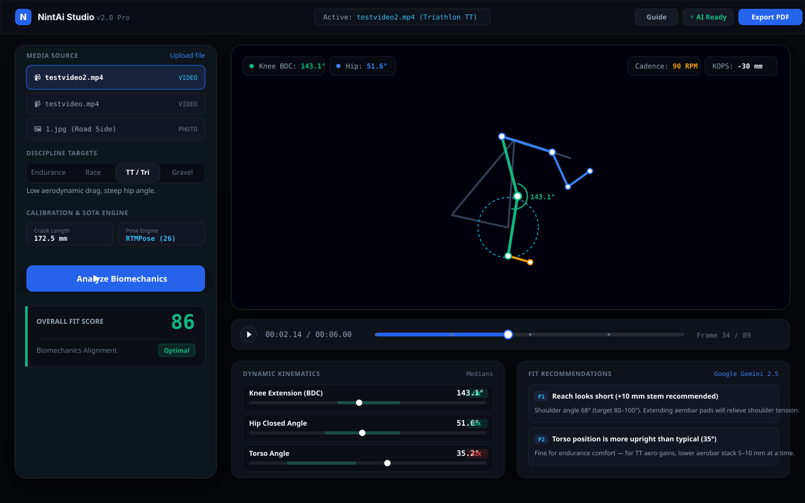

# 🚴 NintAi: The AI-Powered Bike Fit Studio


**NintAi** (Japanese for *Perseverance*, 忍耐) is an open-source, clinical-grade biomechanical bike fitting studio that runs locally on your computer. It combines SOTA pose estimation (**RTMPose Halpe-26** with feet/toes & **Google MediaPipe Pose Heavy**), zero-phase Savitzky-Golay signal filtering, continuous pedal-stroke cycle segmentation, and **Google Gemini AI** to deliver fitting insights comparable to industry tools like MyVeloFit and Retül.

---

## 🖥️ Studio Interface Preview

<div align="center">
  
</div>

*Apple-inspired dark glassmorphism interface featuring interactive frame scrubber, real-time skeleton HUD overlay, per-stroke kinematics gauge bars, and AI coach recommendations.*

---

## ⚡ Quick Start (Launch in 30 Seconds)

### 1. Clone & Install
```bash
git clone https://github.com/pgeedh/NintAi-The-AI-Powered-Bike-Fit-Studio.git
cd NintAi-The-AI-Powered-Bike-Fit-Studio

# Create a virtual environment (recommended)
python3 -m venv .venv
source .venv/bin/activate

# Install dependencies
pip install -r requirements.txt
```

### 2. Launch the Web Studio
```bash
python app.py
```
> The studio automatically opens in your browser at `http://127.0.0.1:8501`.  
> **No video handy?** Click any of the **Quick-Try Sample Cards** on the top carousel to test immediately with real cyclist footage!

---

## 🔑 AI Coach Setup & Authorization

NintAi includes both an **intelligent offline coach** (rule-based biomechanical expert that requires zero setup) and a **Google Gemini 2.5 AI Coach** for deep personalized feedback.

### Authorize Gemini (Optional):
1. **In the Web UI**: Click the **"AI Coach Key"** button in the top navigation bar, paste your key, and click **Save Settings**. (Stored securely in your local browser storage).
2. **Via Environment Variable**:
   ```bash
   export GOOGLE_API_KEY="AIzaSy..."
   ```
3. Get a free API key at [Google AI Studio](https://aistudio.google.com/).
4. *If no key is configured, NintAi automatically falls back to the built-in offline expert coach with zero interruptions.*

---

## 📐 Mathematical Foundations & Kinematics

Unlike simple image markers, NintAi tracks dynamic motion across full pedal revolutions:

```
            (Ear)
              \
           (Shoulder) -------- (Elbow) ----- (Wrist)
              /
            (Hip)
            /   \
         Torso   (Knee)
                  \
                (Ankle)
                /     \
             (Heel) - (Toe)
```

### 1. Inner Joint Angles
* **Knee Extension / Flexion**: $\angle(\text{Hip}, \text{Knee}, \text{Ankle})$
  $$\theta_{\text{knee}} = \arccos\left(\frac{\vec{v}_{kh} \cdot \vec{v}_{ka}}{\|\vec{v}_{kh}\| \|\vec{v}_{ka}\|}\right)$$
  Measured dynamically at **BDC (Bottom Dead Centre, max extension: 140°–150°)** and **TDC (Top Dead Centre, knee flexion: 65°–80°)**.
* **Closed Hip Angle**: $\angle(\text{Shoulder}, \text{Hip}, \text{Knee})$ at TDC (target 45°–55° road).
* **Torso Angle**: Acute angle of the Hip $\rightarrow$ Shoulder vector against the horizontal plane ($0^\circ \le \theta \le 90^\circ$). Independent of whether the rider faces left or right.
* **Shoulder Angle**: $\angle(\text{Hip}, \text{Shoulder}, \text{Elbow})$ for measuring reach.
* **Elbow Bend**: $\angle(\text{Shoulder}, \text{Elbow}, \text{Wrist})$ (relaxed 150°–165° on road, 85°–115° on aero bars).
* **Real Ankling Triangle**: $\triangle(\text{Ankle}, \text{Heel}, \text{Toe})$ tracking heel-toe drop through the stroke.

### 2. Zero-Phase Savitzky-Golay Smoothing
Joint landmark coordinates are filtered using local polynomial regressions ($w = 0.15\,\text{s}, p = 2$). This removes high-frequency computer-vision jitter while preserving genuine extrema without the phase lag introduced by standard moving averages.

### 3. Crank Circle Fitting & Millimetre Scaling (Kasa Algebraic Fit)
The trajectory of the pedal spindle (ball of foot) traces a circular arc in the sagittal plane:
$$(x - c_x)^2 + (y - c_y)^2 = r^2$$
Using known crank arm length (e.g., $172.5\,\text{mm}$), NintAi calculates an exact physical scale:
$$\text{Scale} = \frac{\text{Crank Length (mm)}}{r_{\text{pixels}}}\quad(\text{mm/px})$$

### 4. Law of Cosines Saddle Height Adjustment
Rather than crude guesswork, NintAi solves the leg triangle (thigh $L_1$, shank $L_2$) to compute the exact vertical saddle adjustment in millimetres:
$$d = \sqrt{L_1^2 + L_2^2 - 2 L_1 L_2 \cos(\theta_{\text{knee}})}$$
$$\Delta \text{Saddle} = \left(\sqrt{L_1^2 + L_2^2 - 2 L_1 L_2 \cos(\theta_{\text{target}})} - d_{\text{current}}\right) \times \text{Scale}$$

### 5. Multi-Stroke Statistical Aggregation
Rather than picking a single lucky frame, NintAi automatically isolates 10–30 full pedal revolutions and computes **medians and Interquartile Ranges (IQR)**, filtering out body shifts and anomalous frames.

---

## 🎯 Riding Style Profiles

| Metric | Road Endurance 🚲 | Road Race 🏁 | Triathlon / TT ⏱️ | MTB / Gravel ⛰️ |
| :--- | :---: | :---: | :---: | :---: |
| **Knee Extension (BDC)** | 140° – 150° | 140° – 150° | 140° – 150° | 138° – 148° |
| **Knee Flexion (TDC)** | 65° – 80° | 65° – 80° | 65° – 80° | 65° – 80° |
| **Closed Hip (TDC)** | 50° – 65° | 45° – 55° | 40° – 55° | 55° – 70° |
| **Torso vs Horizontal** | 45° – 55° | 35° – 45° | 10° – 28° | 45° – 60° |
| **Shoulder Angle** | 80° – 95° | 85° – 100° | 80° – 100° | 75° – 90° |
| **Elbow Bend** | 150° – 165° | 150° – 165° | 85° – 115° | 140° – 160° |

---

## 🛠️ CLI Power-User Mode

Prefer the command line? Run video or image analysis directly:

```bash
# Video Analysis with RTMPose Halpe-26 & PDF export
python src/analyze_video.py \
  --input assets/examples/videos/testvideo2.mp4 \
  --profile road_endurance \
  --backend rtmpose \
  --crank_mm 172.5 \
  --output_pdf output/my_fit_report.pdf

# Photo Analysis
python src/analyze_image.py \
  --input assets/examples/images/1.jpg \
  --profile road_endurance \
  --output_pdf output/photo_report.pdf
```

---

## 📁 Repository Architecture

```
NintAi/
├── app.py                  # Main Web Studio launcher (FastAPI + Uvicorn)
├── requirements.txt        # Pinned dependencies (RTMPose, MediaPipe, FastAPI, etc.)
├── assets/
│   ├── ui_preview.svg      # Apple-grade Studio interface render
│   └── examples/           # Pre-bundled demo clips and images
│       ├── videos/         # testvideo.mp4, testvideo1.mp4, testvideo2.mp4
│       └── images/         # 1.jpg, 2.webp, 3.webp, 4.jpeg, 5.jpg
├── src/
│   ├── web/                # Studio 2.0 Web Application
│   │   ├── app.py          # REST API & WebSocket endpoints
│   │   └── static/         # Frontend SPA (HTML5, Apple CSS3, JS)
│   ├── pose_backends.py    # Pluggable SOTA engines (RTMPose Halpe-26 & MediaPipe)
│   ├── biomech.py          # Savitzky-Golay smoothing, crank circle fit, KOPS
│   ├── engine.py           # Unified pure-Python analysis pipeline
│   ├── fit_profiles.py     # Discipline target ranges, scoring & prescriptions
│   ├── report.py           # Publication-quality PDF generation (fpdf2)
│   ├── ai_report.py        # Gemini 2.5 AI Coach with offline fallback
│   ├── core.py             # Geometric primitives & OneEuro filters
│   ├── analyze_video.py    # CLI video runner
│   └── analyze_image.py    # CLI image runner
```

---

## 📄 License & Attribution

Released under the **MIT License**.  
Created with love for the passion of Triathlon by **Pruthvi**.
